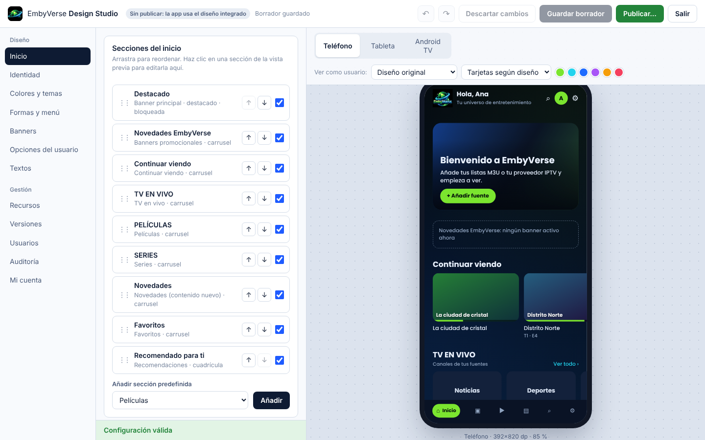
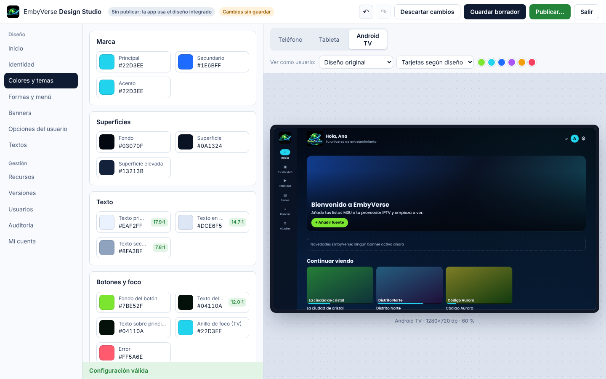
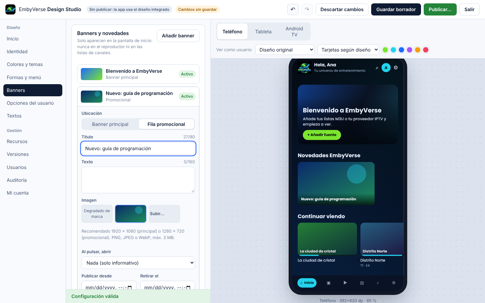

# EmbyVerse

Aplicación OTT/IPTV para Android (teléfono, tableta y Android TV) con reproductor Media3, soporte de listas M3U/M3U8 y servidores compatibles con Xtream Codes, más **EmbyVerse Design Studio**: un panel web para cambiar el diseño de la app y publicarlo sin recompilar el APK.

> EmbyVerse es un reproductor. No incluye, aloja ni vende canales o contenidos. Cada usuario añade sus propias listas o proveedores, y solo debe usar contenido al que tenga derecho de acceso. La app no elude DRM ni controles de acceso.

## Contenido del repositorio

| Carpeta | Qué es | Estado verificado en esta entrega |
|---|---|---|
| `android-app/` | Proyecto Android Studio (Kotlin, Compose, Media3, Room, DataStore, WorkManager) | Módulo `:core` **compilado y probado** (40 pruebas JUnit). Módulo `:app` **compilado en GitHub Actions** (APK publicado); sin probar aún en dispositivo |
| `backend/` | API Node.js 22 + TypeScript sin dependencias de ejecución (SQLite nativo) | **Compilado y probado** (40 pruebas) |
| `admin-web/` | Design Studio (React + TypeScript, empaquetado con esbuild) | **Compilado y probado en Chromium** (15 pasos E2E) |
| `shared/` | `default-config.json`: diseño predeterminado compartido por app, backend y panel | Validado por las tres partes |
| `tests/` | Fixtures compartidos (M3U, XMLTV, configuraciones válidas e inválidas) y prueba E2E del panel | — |
| `docs/` | Arquitectura, compilación, API, esquema, seguridad, privacidad, pruebas y capturas | — |
| `scripts/` | Generación de marca, sincronización, compilación del APK, empaquetado | — |
| `assets/` | Logotipo original y variantes derivadas, licencias de tipografías | — |

## Descargas

- **APK (última compilación):** https://github.com/ositovela-a11y/EmbyVerseTV/releases/download/apk-latest/EmbyVerse.apk
  Se recompila sola con cada cambio en `android-app/` (workflow `APK Android`). Firmada con la clave de depuración del proyecto, para que cada versión se instale encima de la anterior.
  Atajo corto (navegador o Downloader): `ositovela-a11y.github.io/EmbyVerseTV/a`
- **EmbyVerse Web:** https://ositovela-a11y.github.io/EmbyVerseTV/
  Para proveedores `http://` o que bloquean navegadores, activa el **intermediario en la nube** ([docs/RELAY.md](docs/RELAY.md)): funciona en iPhone, Android, PC y TV. Alternativa sin nube: el programa para PC [EmbyVerse Web Local](docs/WEB-LOCAL.md).
- **Cambiar nombre, logo y colores:** [docs/MARCA.md](docs/MARCA.md)

## Lo que NO se pudo hacer en el entorno de la primera entrega

El entorno de desarrollo no tenía Android SDK y su red bloqueaba Google Maven, Maven Central y npm. Por eso **no se generó `EmbyVerse-debug.apk`** y el módulo `:app` no se ha compilado. El código de la app está completo; para obtener el APK sigue [docs/BUILD.md](docs/BUILD.md) (resumen abajo). Si Gradle informa errores de compilación en `:app`, son errores reales sin detectar: la sección "Si la compilación falla" de BUILD.md explica cómo reportarlos.

## Inicio rápido

**1. Backend + panel (en tu servidor o en local)**

```bash
cd admin-web && npm install && npm run build && cd ..
cd backend && npm install && npm run build
ADMIN_EMAIL=tu@email.com ADMIN_PASSWORD='una-contraseña-larga-1' PUBLIC_BASE_URL=https://config.tu-dominio.com npm start
# Panel: https://config.tu-dominio.com  (en local: http://localhost:8080)
```

**2. APK de depuración (en tu computadora, con Android Studio instalado)**

```bash
cp android-app/local.properties.example android-app/local.properties   # ajusta sdk.dir y embyverse.configUrl
./scripts/build-apk.sh                                                 # → out/EmbyVerse-debug.apk
adb install -r out/EmbyVerse-debug.apk
```

**3. En la app:** añade una fuente (lista M3U por URL o archivo, o servidor Xtream con usuario y contraseña), pulsa *Probar conexión* y *Guardar*.

## Documentación

- [Arquitectura](docs/ARCHITECTURE.md) — módulos, flujo de datos y decisiones técnicas
- [Compilar, instalar y actualizar](docs/BUILD.md) — APK debug/release, firma, despliegue del backend
- [API del backend](docs/API.md) — endpoints, roles y errores
- [Configuración remota](docs/remote-config.md) — esquema v1, límites, compatibilidad y reversión
- [Fuentes y proveedores](docs/PROVIDERS.md) — M3U, Xtream Codes, EPG y qué no se admite
- [Seguridad](docs/SECURITY.md) y [Privacidad](docs/PRIVACY.md)
- [Pruebas y resultados reales](docs/TESTING.md) — qué se ejecutó, qué no y cómo probar con streams autorizados
- [Compatibilidad y limitaciones](docs/COMPATIBILITY.md)

## Capturas del Design Studio (generadas por la prueba E2E)

| Teléfono | Android TV | Banners |
|---|---|---|
|  |  |  |
